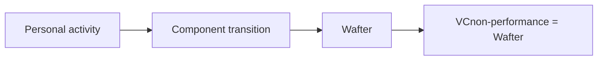

# Founder Wellbeing v0.1 calculation and replay

Status: current operational documentation

Version: `founder-wellbeing-v0.1.1-fixed12`

Owner: Value Log for calculation, occurrence resolution, append-only revisions,
and deterministic replay; HouseOfBros remains the policy issuer.

## Scope

This document explains the additive Founder v0.1 calculation branch. It does
not redefine the HouseOfBros policy, modify production data, or replace the
separate `wim-legacy-v1` Pilot W ledger.

## Bootstrap baseline and component state

Migration `202607280002_founder_wellbeing_v01.sql` introduced append-only
baseline epochs, replay runs, state revisions, and typed value events. The
activated bootstrap uses HouseOfBros policy
`hob-wellbecoming-founder-v0.1`, policy version `0.1.0`, content hash
`e1601b1804716f9ab39314340386d6280993c36db7cb85c364d7a2607477f471`,
and validation mode `founder_self_review`.

| Component | Bootstrap value | Weight |
| --- | ---: | ---: |
| Physiology | 800 | 0.20 |
| Emotion | 750 | 0.10 |
| Feeling | 700 | 0.10 |
| Thought | 880 | 0.20 |
| Habit | 800 | 0.10 |
| Performance | 700 | 0.30 |

The baseline score is `W = 771.00` on a 100–1000 scale. A baseline row is not
treated as a calculated event. Creating it starts a replay whose sequence-zero
state revision records the six-component starting state and the baseline
boundary.

## Event ordering and exact Wbefore

Founder replay begins at the selected baseline epoch and reads active canonical
slices in chronological order. Every transition records its six-component
pre-state and post-state, `w_before`, `w_after`, `delta_w`, policy identity,
calculation version, validation mode, effective time, and replay run.

`Wbefore` is the exact score produced by the preceding revision in that branch.
It is never replaced by a daily average, a rounded display value, or the latest
current state.

For a rate-based Performance event, the quantities are distinct and typed:

```text
community_rate = the hourly policy input (USD_per_hour)
Vcom_event = community_rate × validated duration (USD)
VCperformance_event = (Wbefore / 1000) × Vcom_event
```

`Vcom_event` means the duration-expanded Value for the Commons of one event;
it is not an alias for the hourly community rate. Performance evidence may arrive through
Learning, Earning, or OrgBuilding, while the source community retains its own
task, level, validation, and valuation rules.

The Moses-only Flat Community Rate Policies begin at the exclusive Genesis
boundary `2026-07-28T11:11:34.890018Z`:

| Community | Native level | Learning | Earning | OrgBuilding |
| --- | --- | ---: | ---: | ---: |
| IoV Systems Modeling | `SM3` | USD 750/hour | USD 750/hour | USD 750/hour |
| Growth Flow Engineering | `GFE-3.3.3` | USD 500/hour | USD 500/hour | USD 500/hour |

The IoV policy supersedes the unused USD 7,500/hour task fixture for this
Moses-only scope. The GFE policy supersedes the provisional-only founder rule
for Moses without claiming external validation. Both authorities are honestly
recorded as self-ratified, Moses-only, and final for protocol valuation.
Neither task IDs nor route multipliers enter rate resolution.

Only after the typed Performance value is calculated may the separately
declared HouseOfBros impact move Performance and produce `Wafter`. This prevents
an event from increasing its own multiplier.

The HouseOfBros impact review has three explicit states:

- `applied`: direction and intensity are complete and one transition applies;
- `no_transition`: source settlement may complete without Wellbeing movement;
- `pending`: impact review is incomplete, so settlement and replay wait.

Source-community validation never forces a Performance transition.

## Non-Performance path



For a founder-confirmed non-Performance occurrence, replay updates the affected
component once under the nine-band HouseOfBros matrix, recalculates `Wafter`,
and stores:

```text
VCnonperformance_event = Wafter
deltaW = Wafter - Wbefore
```

The snapshot and the delta have different meanings. Neither is numerically
added to `VCperformance_event`; Wellbeing points, currencies, credits, and
other contribution units remain typed.

## Occurrence and attestation identity

`activity_occurrence_id` identifies one real activity occurrence. Several
non-overlapping slices may contribute to its validated duration, but their
union creates one component transition. The replay and database uniqueness
constraints permit at most one state revision and one value event for that
occurrence in one replay branch.

`source_attestation_id` identifies the skill-community attestation supporting a
Performance event. `performance_transition_key` is derived from subject,
source community, source attestation, and policy version. It permits at most
one logical Performance transition for the attestation in one branch.

The two keys solve different problems: occurrence identity prevents time-slice
fragmentation from multiplying movement; attestation identity prevents
duplicate delivery, retry, or adapter migration from multiplying a Performance
transition.

## Idempotency, correction, and reversal

- Repeating the same delivery reuses stable occurrence and attestation
  identity; it does not create another logical movement.
- Correcting a canonical slice creates a replacement revision and starts
  replay from the earliest affected time.
- Superseding a duplicate retains the original audit history and excludes the
  superseded slice from the new active branch.
- A policy migration recalculates or supersedes the transition under a new
  versioned branch. It does not stack a second transition.
- Existing append-only reversals and canonical supersession records remain
  preserved. Founder state is corrected through a new replay run and new state
  revisions; prior completed branches are not mutated.

A completed replay is only a candidate. Verification records the exact input
and output hashes, cutoff, baseline, policy and authority hashes, arithmetic
version, event counts, null-reason completeness, and invariant results.
Promotion is a separate append-only record referencing one completed passing
verification. Every current-state, Today, Insights, Profile, Replay, export,
publication, and Word Wallet reader uses only the explicitly promoted branch.
An unverified or unpromoted completed run remains invisible. Verification or
promotion failure leaves the prior promoted branch active.

## Bitemporal resolution and exact arithmetic

Policy and authority versions carry occurrence-valid time (`valid_from`,
exclusive `valid_to`) and database-generated transaction time (`recorded_at`).
Resolution receives both the occurrence time and the caller's system-time
cutoff. A retroactive policy is therefore invisible to a query whose system
time predates recording, even when the occurrence is inside the policy's valid
interval.

Founder eligibility is determined only by the database comparison
`occurrence_start_at > genesis_effective_at`. Equality and every earlier
timestamp are excluded; one database microsecond later is eligible.
Application date comparison does not authorize calculation.

Governed arithmetic uses signed integers scaled by `10^12`. PostgreSQL
`NUMERIC` values cross the application boundary as decimal strings, TypeScript
uses `bigint`, and every division uses round-half-even. Timestamp microseconds
from the database determine validated duration. Presentation rounding is
separate and cannot enter hashes, replay comparisons, or subsequent W state.

Every unresolved canonical quantity carries a constrained reason code.
Numeric zero is always a calculated value, never a substitute for null.

## Valuation finality is non-payable

`protocol_finality_status = final` means only that valuation is final under
the named policy branch. Every such value also records
`payability_status = non_payable`, its finality authority version, and
finalization time. It is not payment settlement, compensation, debt,
entitlement, a transferable balance, or a claim about human worth.

## Preview and live modes

- `legacy` disables the additive founder branch and leaves Pilot W operation
  unchanged.
- `founder_v0_1_preview` calculates a private candidate branch for inspection.
  It does not authorize publication or become current without verification
  and explicit promotion.
- `founder_v0_1_live` calculates the authoritative founder branch for the
  configured allowlist and enables signed projection delivery.

Confirmed founder observations apply no confidence multiplier. Inferred or
uncertain observations remain preview-only until confirmed. For Moses only,
IoV SM3 and GFE-3.3.3 rate authority is self-ratified and may finalize
non-payable valuation. No external reviewer or external attestation is
claimed. A future independent review must be a new authority version.

## Legacy Pilot W preservation and replay boundary

Founder v0.1 is additive. It does not reinterpret, overwrite, or delete
historical Pilot W inputs, calculations, normalized values, reversals, or
projections. `wim-legacy-v1` retains its original weights, intensity, confidence
semantics, tables, tests, and replay behavior, clearly labelled historical.

The founder branch begins at its declared baseline epoch. Events earlier than
that boundary are not retroactively converted into founder movements. A later
calibration creates a prospective epoch; it does not decompose or rewrite a
legacy scalar score.

## Rollout state

- Mode: `founder_v0_1_live` for the founder allowlist.
- The additive migration, fixed-point worker, promotion-aware readers, and
  community/spec contracts must pass their repository checks and a fixed-cutoff
  read-only dry run before production application.
- Production replay and promotion are controlled rollout operations, not an
  implied consequence of merging code.
- Word Wallet founder disclosure controls: private.
- Public Foundation score rendering: absent while disclosure remains off.

## Contract and test references

- Calculation constants and transition functions:
  [`src/lib/founder-wellbeing.ts`](../src/lib/founder-wellbeing.ts)
- Chronological branch construction:
  [`src/lib/founder-replay.ts`](../src/lib/founder-replay.ts)
- Database persistence:
  [`src/lib/founder-replay-server.ts`](../src/lib/founder-replay-server.ts)
- Projection contract:
  [`src/lib/founder-wellbeing-projection.ts`](../src/lib/founder-wellbeing-projection.ts)
- Additive schema:
  [`supabase/migrations/202607310001_bitemporal_flat_community_rates.sql`](../supabase/migrations/202607310001_bitemporal_flat_community_rates.sql)
- Tests:
  [`src/lib/founder-wellbeing.test.ts`](../src/lib/founder-wellbeing.test.ts),
  [`src/lib/founder-replay.test.ts`](../src/lib/founder-replay.test.ts), and
  [`src/lib/founder-documentation.test.ts`](../src/lib/founder-documentation.test.ts)
- [HouseOfBros policy](https://github.com/houseofbroscommunity/houseofbros-wellbecoming-policy/blob/main/POLICY.md)
- [Central IoV ADR](https://github.com/TheInternetOfValue/the-internet-of-value-spec/blob/main/docs/adr/community-governed-wellbeing-mathematics.md)
